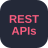
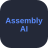
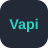

<h1 align="center">  </h1>

  

<!-- Social Links -->

  
  
  
  
  
  
  
  

  

## About Me

<table width="100%" cellspacing="0" cellpadding="0" border="0" style="border: none;">
<tr style="border: none;">
<td width="55%" valign="middle" style="border: none;">

I am a versatile developer who easily adapts to different roles (Full Stack Web Developer, AI/ML Engineer, App Developer, or Data Analyst) depending on what the project requires. I love exploring new tech stacks and leveraging them to build impactful solutions.

Currently pursuing **B.E. in CSE @ Osmania University** (CGPA: 9.90) and **B.S. in Data Science @ IIT Madras** (CGPA: 8.87).

- Software Management Trainee @ **Deloitte** (DashVerify)
- Published 2 research papers: **TruthLens** (IJSREM) and **MedSync-AI** (IJAR)
- Multi-time **National Hackathon Winner** (20+ podium finishes)
- **Claude Certified Architect - Professional** (Anthropic)
- Recipient of **Gold Medals** at Osmania University and **Certificate of Merit** at IIT Madras

</td>

<td width="45%" align="center" valign="middle" style="border: none;">

</td>
</tr>
</table>

### Languages and Tools:

<h4>Languages &amp; Databases</h4>

  
  
  
  
  
  
  
  
  
  
  
  
  
  
  

<h4>Frontend, Mobile &amp; Backend</h4>

  
  
  
  
  
  
  
  
  
  
  
  
  
  
  
  
  
  
  
  
  
  
  
  
  
  
  

<h4>AI / ML &amp; Data Science</h4>

  
  
  
  
  
  
  
  
  
  
  
  
  
  
  
  
  

<h4>APIs, Cloud &amp; DevOps</h4>

  
  
  
  
  
  
  
  
  
  
  
  
  
  
  
  

## Experience

| Role | Organisation | Duration | Work |
|---|---|---|---|
| **Software Management Trainee** | Deloitte Touche Tohmatsu India LLP (Onsite) | Jun 2026 - Nov 2026 | DashVerify, Deloitte's AI-Driven Background Verification Service: AI-powered education and employment validation platform with automated document verification, and an AI code generation system |
| **AI Intern** | Piazza Consulting Group (PTCG India) (Onsite) | May 2026 - Aug 2026 | Wealth-Map, Gurukul AI LMS, LangGraph-based CRM automation, voice AI calling systems, enterprise AI agents for workflow automation |
| **AI/Automation Intern** | Druva Moksh (Remote) | Feb 2026 - Sept 2026 | MCP modules, AI client support/knowledge agents, WhatsApp-integrated n8n workflows, LearnBot (LangChain); contributed to BaapStore E-Commerce and Natyam AI platforms |
| **Software Engineer Trainee** | Evol Jewels Pvt. Ltd. (Onsite) | Jan 2026 - Jul 2026 | Rebuilding the official e-commerce platform with Medusa.js, Next.js, TypeScript, Bun, tRPC, Drizzle ORM and cloud infra (NeonDB, Cloudinary, AWS) |
| **Data Analyst / MIS Intern** | Hyderabad Water Supply Board (Onsite) | Nov 2025 - Feb 2026 | Flask-based analytics platform and revenue querying system using Python, PostgreSQL and Tableau |
| **Summer Research Intern** | SRISHTI 2025, IIIT Hyderabad (Onsite) | Jul 2025 - Jul 2026 | Research on AI/ML systems in speech processing, deception detection and behavioral modelling |
| **Cyber Security Intern** | Supraja Technologies (Hybrid) | May 2024 - Aug 2024 | MySQL-based USB security system with OTP authentication and system protection automation |

## Publications

- **TruthLens: AI-Powered Fake News and Misinformation Detection Using Multimodal Analysis** (IJSREM, 2025)
- **MedSync-AI: A Retrieval-Augmented Generation Pipeline for Context-Aware Medical Question Answering** (IJAR, 2025)

## Education

| Institution | Programme | Duration | Highlights |
|---|---|---|---|
| **University College of Engineering, Osmania University** | B.E. in Computer Science and Engineering (CGPA: 9.90) | 2023 - Present | (Late) Sri Pendyala Srinivas and (Late) E. Srinivasa Rao Gold Medals |
| **Indian Institute of Technology, Madras** | B.S. in Data Science and Applications (CGPA: 8.87) | 2023 - Present | Certificate of Merit for Academic Excellence (2025); Mentor for Modern Application Development I, II and TA for Machine Learning Practice |
| **Villa Marie Junior College for Girls** | Intermediate: MPC (CGPA: 9.81) | 2021 - 2023 | |
| **St. Mark's Progressive High School** | Secondary and Senior Secondary (CGPA: 10.00) | 2008 - 2021 | |

## Certifications, Programs & Badges

- **Claude Certified Architect - Professional** (Anthropic), Sept 2026
- **Claude Certified - Foundations** (Anthropic): Associate, Developer, Architect, Aug 2026
- **AWS Academy Graduate - Cloud Foundations** (Amazon Web Services), Jul 2026
- **AWS AI & ML Scholars - 2026 Challenge** (Udacity), Mar 2026
- **Hands-on Workshop on IoT-AI for Healthcare** (IIIT Hyderabad), 5th - 7th Dec 2025
- **Artificial Intelligence Fundamentals** (IBM SkillsBuild), Oct 2025
- **9th Summer School on AI** (CVIT, IIIT Hyderabad), Jul 2025
- **Google Cybersecurity Professional Certificate** (Google & Coursera), Dec 2024
- **CCBP 4.0 Intensive Fellowship** (NxtWave Academy), 2024 - 2025
- **Certificate Program on Machine Learning** (IIIT Hyderabad), 2024 - 2025

## Achievements

- **Winner**: Megathon X: Singularity 2026 (IIITH, Lloyds-B Problem Statement)
- **Winner**: Rebrand, Saavan 2026 (IITM)
- **Winner**: Hack Novate 2025 (MCET, Agentic AI Track)
- **Winner**: Hack Revolution 2025 (MJCET, Urban Tech and Smart Cities Track)
- **Winner**: AI Design Contest (IEEE I4C Conclave, AI in Healthcare Theme)
- **1st Runner-Up**: HackArena 2024 (National-Level Hackathon)
- **1st Runner-Up**: Hack Sprint (IITM - Margazhi Fest)
- **1st Runner-Up**: VNR-VJIET Designathon 2025
- **1st Runner-Up**: Hack4Good (UCEOU - Infinity 2025)
- **1st Runner-Up**: Project Expo 2025 (LIET - Sanketika, Software Track)
- **1st Runner-Up**: Innovasia 2025 (Vasavi College of Engineering, FinTech & MedTech Track)
- **1st Runner-Up**: Datanyx 2025 (MJCET, MedTech Track)
- **1st Runner-Up**: HackSavvy 2026 (MGIT, AI, Automation, Robotics and Drone Technology Track)
- **1st Runner-Up**: Grand Theft Analytica 2.0, Saavan 2026 (IITM)
- **2nd Runner-Up**: Project Expo 2026 (LIET - Sanketika, Software Track)
- **2nd Runner-Up**: ByteBash 2025 (IITM)
- **2nd Runner-Up**: Techthon 2025 (SWCET, Software Domain)
- **2nd Runner-Up**: Hack The Vibe 2025 (Productivity Track)
- **2nd Runner-Up**: Pitchstorm 2025 (IITM)
- **2nd Runner-Up**: Hack for Infinity (UCEOU, AI for Ability Track)
- **Consolation**: Hackathon 2026 (St. Anns College for Women, AI Track)
- **NPTEL Star (2024-2026)**: Believer, Discipline Star, Enthusiast and Motivated Learner

<h2 align="center" style="color: #F85D7F;">GitHub Stats</h2>

  
  

  

  

  

